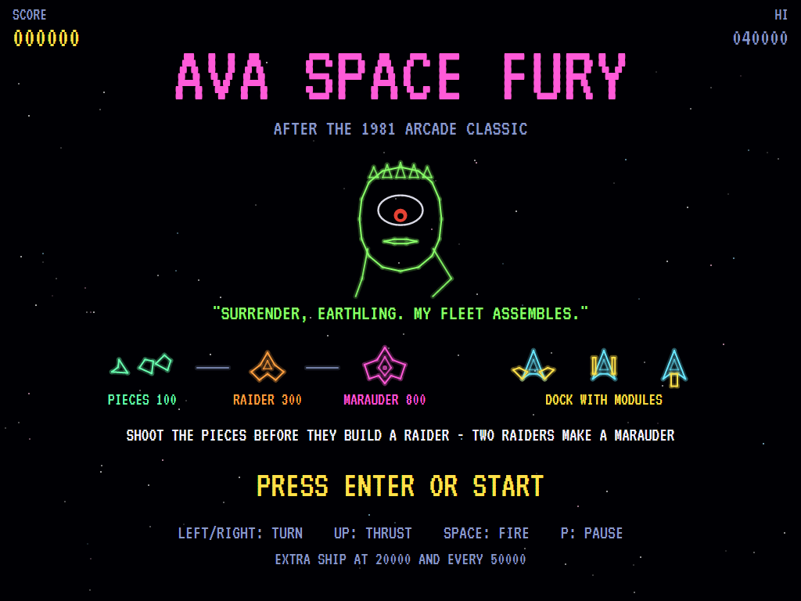
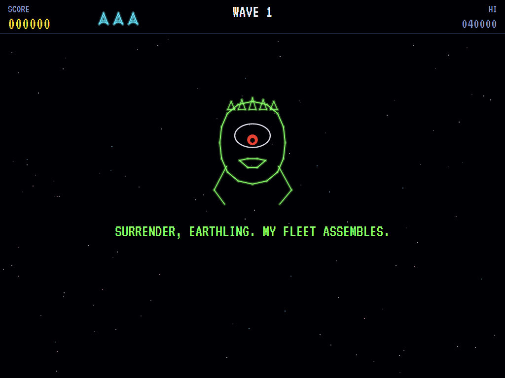
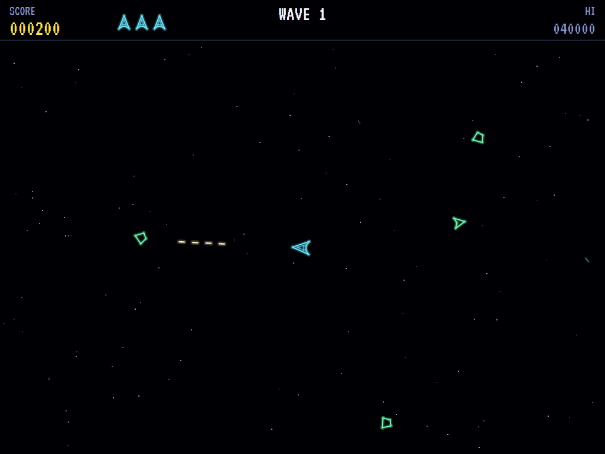
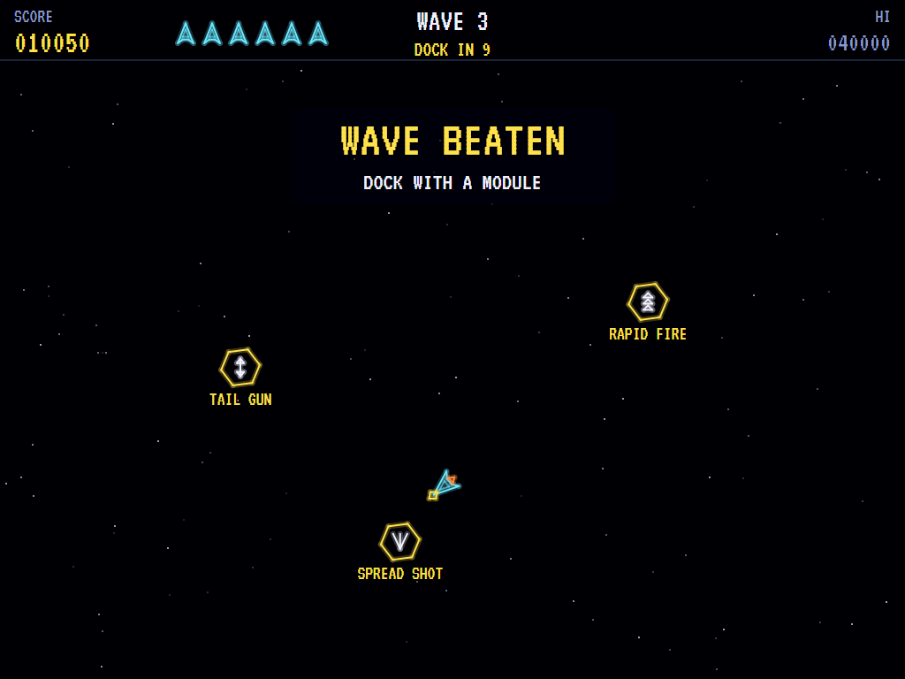
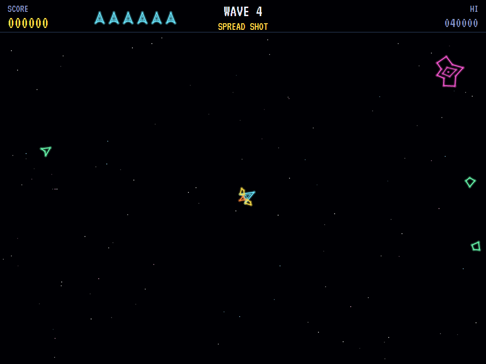
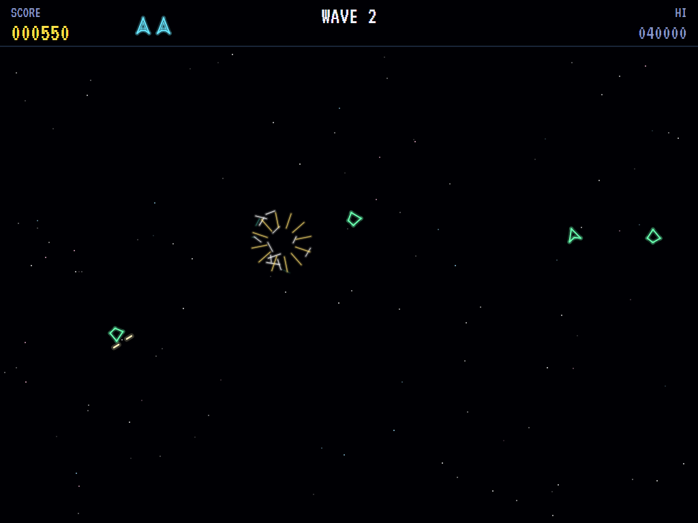
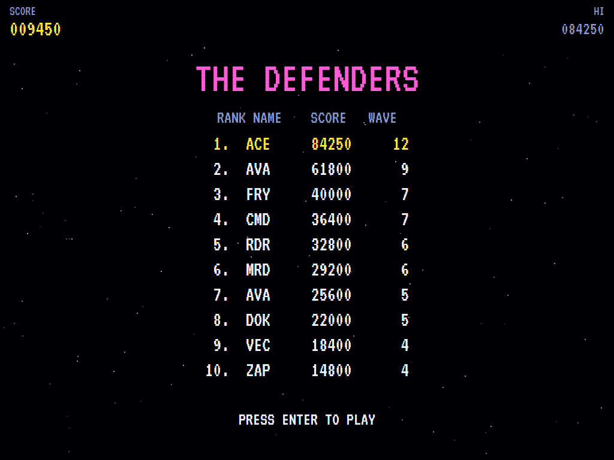

# AVA Space Fury

[](https://github.com/Harlock123/AVASpaceFury/actions/workflows/build.yml)

A colour vector space shooter in the style of Sega's 1981 arcade game **Space Fury**, built with .NET 10
and Avalonia UI. Turn and thrust your ship through wrapping space as the alien Commander's fleet builds
itself around you. Pieces fly together to make Raiders, and Raiders merge into Marauders. Between waves,
dock with an add-on module for more firepower, before the Commander taunts you again.

## Features

- **Your ship**:
  - **Flying:** it turns and thrusts with inertia and drifts on, slowing gently, through space that wraps at every edge.
  - **Firing:** it fires a few shots at a time. Hold the trigger to keep firing.
  - **After losing a ship:** the next one blinks for a moment, and can't be hurt while it does.
- **The Commander's fleet**:
  - **Fragments** come in from the edges in threes and fly together to a meeting point. Shoot them before they get there.
    - **Two left:** if you shoot one, the other two still meet and make a Raider.
    - **One left:** a lone survivor flashes red and comes straight for you.
  - **Raiders**, assembled from the pieces, hunt your ship, weaving as they come. They fire, mostly leading their aim.
  - **Marauders:** from wave 3, a Raider with a partner near by goes to join it, and the two merge into a Marauder. It is bigger and slower, fires a fan of three, and takes three hits.
- **Docking**:
  - **The modules:** when a wave is beaten, three different add-on modules circle the middle of the screen. Fly into one within ten seconds to dock with it, for a bonus that's bigger the quicker you dock.
  - **What they do:**
    - **Twin cannons:** two shots side by side.
    - **Spread shot:** a fan of three.
    - **Tail gun:** fires backwards too.
    - **Rapid fire:** quicker, with more shots in the air.
  - **Keeping it:** a module stays until you lose the ship.
- **The Commander**: a one-eyed alien with a ridged crown. His eye follows your ship as he taunts you in a robotic voice before every wave.
- **Waves**: each sends more threes, faster, and its Raiders fire more often.
- **Scoring**:

  | | Points |
  |---|---|
  | Fragment | 100 (a lone one 150) |
  | Raider | 300 |
  | Marauder | 800 |
  | Docking | 1,000, plus 100 for each second left |

  - **Extra ships** come at 20,000 and every 50,000 after that.
- **Sound**:
  - **The title tune:** an original space anthem in C minor.
  - **The effects:** the zap of your gun and the blat of theirs, the thruster, pieces clicking together and Raiders fusing, the docking clunk and chime, the Commander's robotic voice, and the hum of space.
  - All of it is synthesised and mixed by OpenAL.
- **Attract mode**: leave the title alone for 15 seconds and a computer pilot plays. It docks between waves, slips out of the way of anything about to hit it, and leads its shots on the nearest enemy.
- **A top-ten high-score table** with arcade-style initials entry. It records the wave reached.
- **Gamepads** through SDL2, as well as the keyboard.
- **Any window size**: the screen scales to fit, letterboxed. **Ctrl+S** saves a screenshot.
- **One self-contained executable** per platform: Windows, macOS and Linux on Intel/AMD and ARM.

## Screenshots

| The title | The Commander | The fleet assembling |
|:---------:|:-------------:|:--------------------:|
|  |  |  |
| Pieces, Raiders, Marauders and modules. | His taunt before each wave. | The pieces on their way. |

| Docking | A Marauder | Destroyed |
|:-------:|:----------:|:---------:|
|  |  |  |
| Pick a module. | Two Raiders merged. | One shot too many. |

| The defenders | | |
|:-------------:|:-:|:-:|
|  | | |
| The high-score table. | | |

The screenshots are made by the tests, which play the game in a real (headless) window; see
[Tests](#tests).

## Download and run

Ready-to-run builds for Windows, macOS and Linux, on both Intel/AMD and ARM, are on the
[Releases page](https://github.com/Harlock123/AVASpaceFury/releases/tag/latest). **Latest build** is
rebuilt on every push to `main`. Each download is one self-contained executable: no .NET install is
needed.

| Platform | Archive |
|---|---|
| Windows | `AVASpaceFury-win-x64.zip`, `AVASpaceFury-win-x86.zip`, `AVASpaceFury-win-arm64.zip` |
| macOS | `AVASpaceFury-osx-arm64.tar.gz` (Apple silicon), `AVASpaceFury-osx-x64.tar.gz` (Intel) |
| Linux | `AVASpaceFury-linux-x64.tar.gz`, `AVASpaceFury-linux-arm64.tar.gz`, `AVASpaceFury-linux-arm.tar.gz` |

```bash
tar -xzf AVASpaceFury-linux-x64.tar.gz     # or linux-arm64, linux-arm, osx-arm64, osx-x64
./AVASpaceFury
```

On Windows, unzip and run `AVASpaceFury.exe`. On macOS, if Gatekeeper refuses to open it, run
`xattr -d com.apple.quarantine AVASpaceFury` once. Run with `--no-audio` for silence.

**Sound** comes through OpenAL Soft, built in for every platform. In a virtual machine the game
detects it and uses a larger audio buffer, so the sound doesn't break up.

**Gamepads** use SDL2, which is bundled for Windows, macOS and Intel/AMD Linux. ARM Linux builds need it
installed; without it the keyboard still works:

```bash
sudo apt install libsdl2-dev            # Debian / Ubuntu / Raspberry Pi OS
sudo pacman -S --needed sdl2-compat     # Arch / Omarchy
```

## Controls

| Input | Action |
|-------|--------|
| **Enter** | Start |
| **Left** / **Right** (or **A** / **D**) | Turn |
| **Up** / **W** | Thrust |
| **Space** / **Z** / **X** / **Ctrl** | Fire (hold to keep firing) |
| **P** / **Esc** | Pause (Esc again to quit) |
| **M** | Mute |
| **Ctrl+S** / **Cmd+S** | Save a screenshot to the Pictures folder |

**Gamepad**: left stick or D-pad to turn (up, or **B**, to thrust), **A** or **X** to fire, **Start** to
start and pause, **Back** (while paused) to quit.

**Entering initials**: type letters, or dial with **Up**/**Down** and accept with **Space**; **Left** /
**Backspace** go back; **Enter** finishes.

## Tests

```bash
dotnet test AVASpaceFury.slnx
```

The engine has no UI and runs in fixed 60 Hz steps, so it plays the same at any frame rate, and a seed
always plays the same game. The tests check:

- **The ship:**
  - turning, thrusting, drifting and slowing
  - space wrapping round
  - a few shots at a time
  - each module's guns
- **The enemy:**
  - three fragments assembling into a Raider, and two still doing so
  - the last of three coming straight for you
  - Raiders hunting and firing
  - Marauders merging from wave 3 and taking three hits
- **Losing ships:**
  - to shots and rammers
  - the module going with the ship
  - the moment's safety after coming back
  - the last ship ending the game
- **Waves and docking:**
  - the Commander's taunt
  - three different modules after a wave
  - docking, its bonus and the next wave
  - missing the docking
  - bigger, quicker waves
  - extra ships
- **The machine:** the attract cycle, the computer pilot beating the first waves and docking, the same game from the same seed, and pausing

The screenshot tests draw the real screen in a headless window. To refresh the README's pictures:

```bash
FURY_SHOTS=$PWD/Images dotnet test tests/AVASpaceFury.Tests --filter ScreenshotTests
```

To see how the computer pilot gets on, wave by wave (for tuning), or how a player who just sits and fires
does (`FURY_PROBE=lazy`):

```bash
FURY_PROBE=1 dotnet test tests/AVASpaceFury.Tests --filter PilotProbe --logger "console;verbosity=detailed"
```

## Building

```bash
dotnet build AVASpaceFury.slnx
dotnet run --project src/AVASpaceFury
```

Needs the .NET 10 SDK. The sounds are made by `tools/make_sounds.py` (standard-library Python):
`python3 tools/make_sounds.py` rewrites `src/AVASpaceFury/Sounds`.

## Project structure

```
AVASpaceFury/
├── AVASpaceFury.slnx
├── src/AVASpaceFury/
│   ├── Engine/
│   │   ├── GameEngine.cs        # States, the title and demo cycle, and the hum of space
│   │   ├── GameEngine.Play.cs   # The ship and its modules, fragments, Raiders and Marauders,
│   │   │                        # docking, the Commander's taunts, and scoring
│   │   ├── ShipPilot.cs         # The computer pilot, for the demonstration (and the tests)
│   │   ├── Entities.cs          # Wrapping space, the ship, shots, fragments, Raiders, modules
│   │   ├── HighScoreTable.cs, InitialsEntry.cs
│   │   ├── InputHandler.cs, ControllerManager.cs  # Keys and an SDL2 gamepad
│   │   └── SoundManager.cs      # Effects and the tunes through OpenAL
│   ├── Audio/                   # The OpenAL engine (from the author's AVABand)
│   ├── Views/                   # The vector ship, the fleet, the modules, the Commander, the screens
│   └── Sounds/                  # The synthesised effects, the Commander's voice and the tunes
├── tests/AVASpaceFury.Tests/    # Gameplay, screenshot and probe tests
├── tools/make_sounds.py
└── Images/                      # Screenshots
```

## About and licence

AVA Space Fury © 2026 Lonnie Watson, under the [MIT License](LICENSE).

*Space Fury* © 1981 Sega; the name belongs to its current owner. AVA Space Fury is an independent,
unofficial game in its style. Its ship, its fragments, Raiders and Marauders, its modules, its Commander
and everything he says, its graphics, sounds, tunes and code are its own; nothing is taken from the
arcade machine's program, graphics, speech, sound or music. It is not affiliated with or endorsed by any
rights holder.
